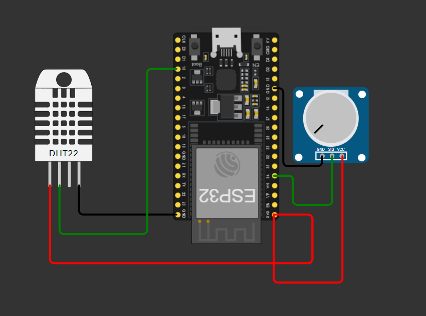
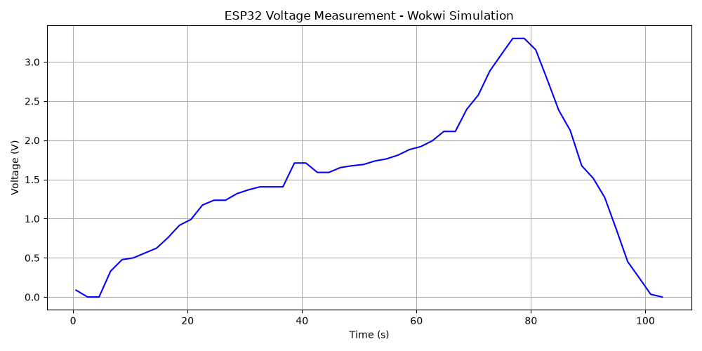
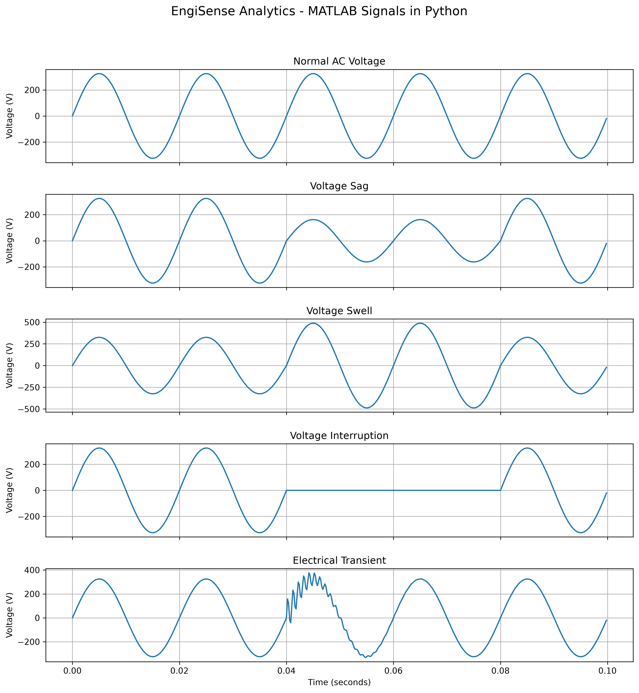
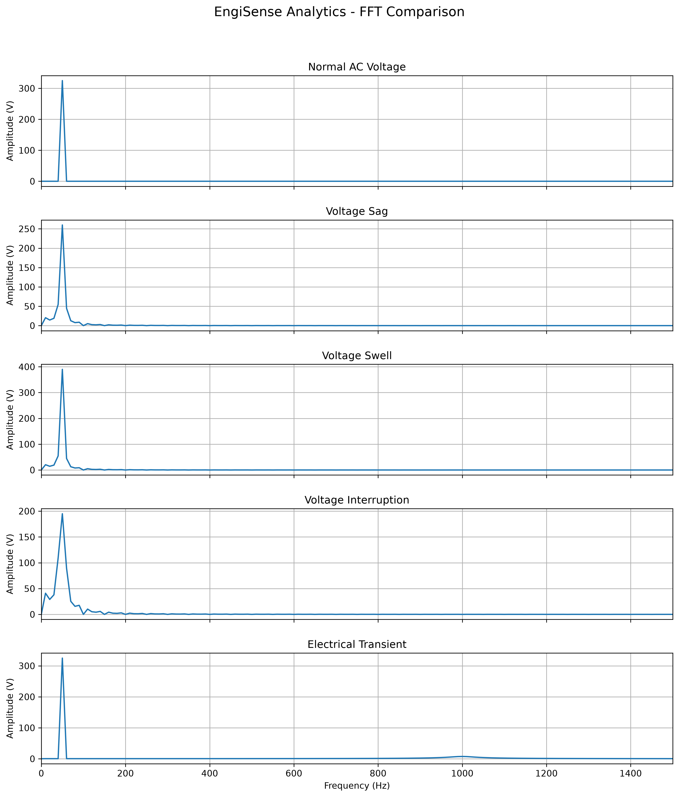
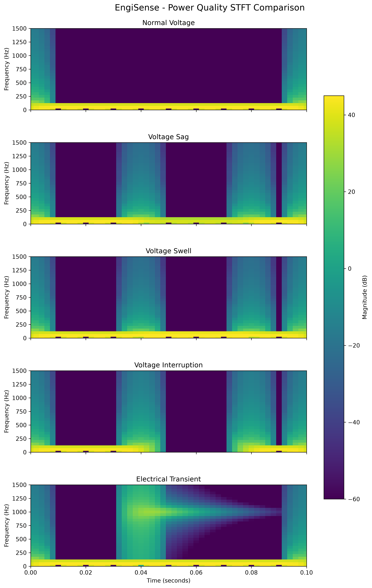
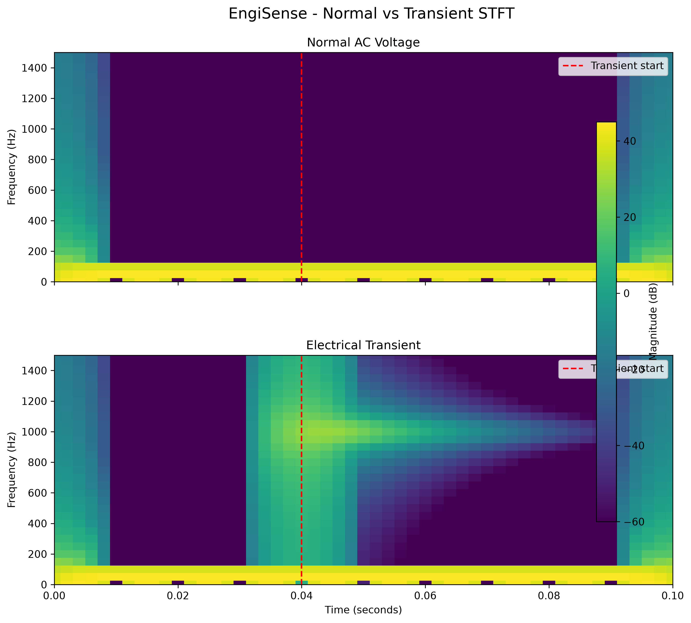
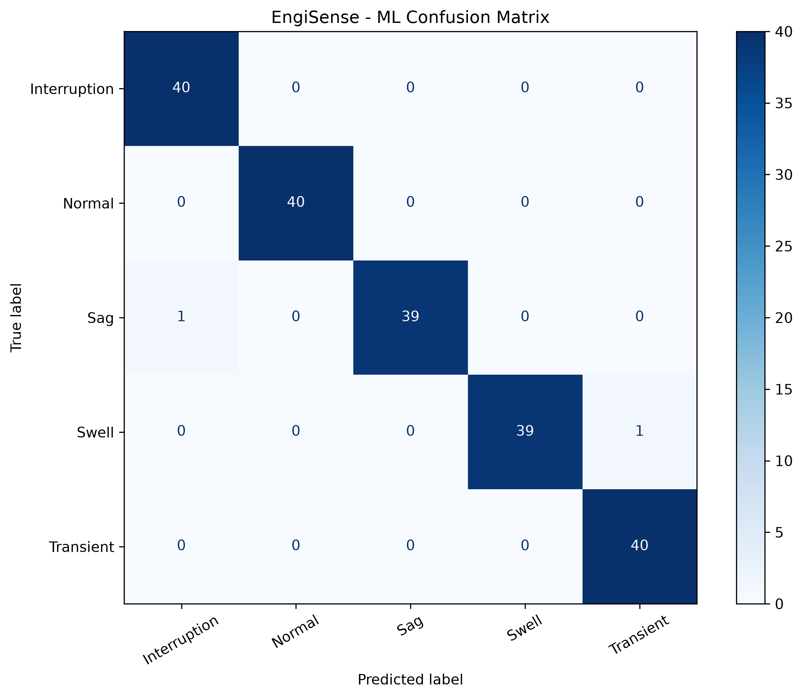
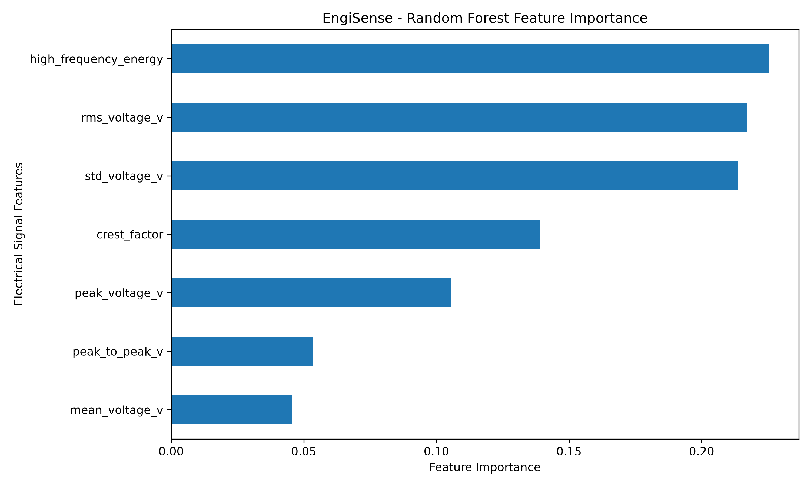
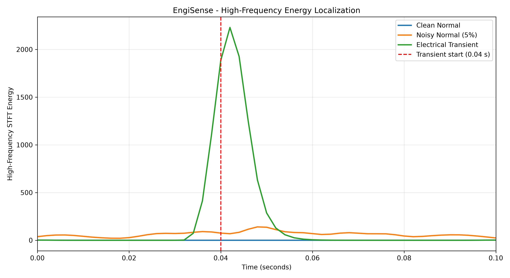

# *****_EngiSense Analytics_*****

### Intelligent Engineering Systems | Monitoring, Signal Processing & Smart Fault Diagnostics

**From embedded sensor measurements to power-quality analysis and machine-learning-based disturbance identification.**

**Developed by [Simanto Howladar Soumyo](https://github.com/Simanto-01)**


---

## Overview

**EngiSense Analytics** is a simulation-based electrical engineering project that brings together embedded systems, MATLAB, digital signal processing, machine learning, and interactive data visualization.

I developed this project to explore how electrical measurements can be processed, interpreted, and used to identify different power-quality disturbances. The idea was to build more than a collection of separate simulations: I wanted a connected workflow that takes measurements from their source, analyzes them, and presents the results in a useful engineering interface.

The project has two main data sources. An ESP32 circuit simulated in Wokwi provides temperature, humidity, and analog voltage readings. MATLAB generates AC voltage waveforms representing normal operation and several electrical disturbances. Python handles data processing, spectral analysis, feature extraction, and machine-learning classification.

As the project developed, an important limitation became clear. Although the Random Forest classifier performed well on its synthetic test dataset, its accuracy dropped when additional noise was introduced. That led to a separate investigation into transient detection using the Short-Time Fourier Transform (STFT) and the temporal concentration of high-frequency energy.

The result is **EngiSense Analytics V1**, an engineering prototype that combines monitoring, analysis, classification, and experimental validation in a Streamlit dashboard.

This is a research and portfolio project, not a certified electrical monitoring or protection system.

### Project Highlights

- ESP32 sensor monitoring using Wokwi
- MATLAB simulation of 50 Hz AC voltage and power-quality disturbances
- RMS, peak voltage, crest factor, and other time-domain measurements
- FFT-based frequency analysis
- STFT-based time-frequency analysis
- Random Forest classification of five power-quality conditions
- Controlled noise-robustness experiments
- Physics-informed electrical transient detection
- Interactive Streamlit dashboard

---

## 1. System Architecture

EngiSense Analytics uses two independent simulation workflows that feed into a shared Python analytics environment.

The ESP32 simulation demonstrates embedded sensor acquisition. The MATLAB simulation provides higher-sampling-rate voltage waveforms suitable for studying electrical disturbances.

```text
                         ENGISENSE ANALYTICS
                                  |
                 +----------------+----------------+
                 |                                 |
            ESP32 / WOKWI                        MATLAB
           Sensor Simulation              Power-Quality Simulation
                 |                                 |
          DHT22 Measurements                  Normal Voltage
          ADC Voltage Input                    Voltage Sag
                 |                             Voltage Swell
                 |                         Voltage Interruption
                 |                         Electrical Transient
                 |                         Harmonic Distortion
                 |                                 |
                 v                                 v
            CSV Export                        CSV Export
                 |                                 |
                 +----------------+----------------+
                                  |
                                  v
                            PYTHON ANALYTICS
                                  |
                   +--------------+--------------+
                   |                             |
             Data Processing              Signal Processing
                   |                             |
             Data Validation                 RMS / FFT / STFT
             Feature Extraction              Spectral Analysis
                   |                             |
                   +--------------+--------------+
                                  |
                                  v
                         INTELLIGENT ANALYSIS
                                  |
                         Random Forest Model
                         Noise Robustness Tests
                         Transient Event Detector
                                  |
                                  v
                          STREAMLIT DASHBOARD
                                  |
                         Sensor Measurements
                         Electrical Waveforms
                         Frequency Spectra
                         Classification Results
                         Transient Detection
```

**Important distinction:** The ESP32 measurements are not used to sample the 50 Hz mains waveform. They demonstrate low-rate embedded sensor acquisition, while the MATLAB signals provide the electrical waveforms used for power-quality analysis and classification.

---

## 2. ESP32 Sensor Monitoring

### 2.1 Circuit Design and Wokwi Simulation

The embedded monitoring setup was developed using an ESP32 microcontroller in Wokwi.

The circuit includes a DHT22 sensor for temperature and humidity measurements and a potentiometer connected to an ESP32 analog input. Adjusting the potentiometer changes the input voltage measured by the microcontroller's ADC.

This provides a simple but useful starting point for working with sensor interfaces, analog measurements, serial output, and structured data collection.



*Figure 1. ESP32 circuit simulated in Wokwi, showing the DHT22 sensor and potentiometer.*

The simulation files are available in `firmware/wokwi_esp32/`, including the Arduino sketch, circuit diagram, and library configuration.

### 2.2 Data Acquisition

The Wokwi simulation produced **52 sensor readings**.

The exported dataset includes the following fields:

| Field | Description |
|---|---|
| `time_ms` | Timestamp in milliseconds |
| `temperature_c` | Temperature in °C |
| `humidity_pct` | Relative humidity in % |
| `adc_raw` | Raw ADC reading |
| `voltage_v` | Calculated ADC voltage in V |

A summary of the collected measurements is shown below.

| Parameter | Approximate result |
|---|---:|
| Mean temperature | 24 °C |
| Mean humidity | 40% |
| Mean ADC voltage | 1.48 V |
| Sampling frequency | 0.498 Hz |
| Number of samples | 52 |

The simulated ADC input operates over a nominal voltage range of approximately 0–3.3 V.

### 2.3 ADC Voltage Analysis

The potentiometer voltage was recorded over time and visualized in Python.



*Figure 2. ADC voltage measurements collected from the Wokwi ESP32 simulation.*

This plot demonstrates the path from a simulated analog input to a recorded dataset and a Python visualization.

The original measurements are stored in:

`data/raw/wokwi/esp32_sensor_data.csv`

The integrated dataset is stored in:

`data/unified/esp32/esp32_integrated.csv`

The integration step retains the original readings while adding a time value in seconds and a source identifier.

---

## 3. MATLAB Power-Quality Simulation

### 3.1 Reference AC Signal

MATLAB was used to generate a reference AC voltage waveform and several representative electrical disturbances.

The reference sinusoidal voltage is described by:

$$
v(t) = V_m \sin(2\pi f t)
$$

where:

- $v(t)$ is the instantaneous voltage.
- $V_m$ is the peak voltage.
- $f$ is the fundamental frequency.
- $t$ is time.

The simulation parameters are:

| Parameter | Value |
|---|---:|
| Fundamental frequency | 50 Hz |
| Peak voltage | 325 V |
| Sampling frequency | 5,000 Hz |
| Simulation duration | 0.1 s |
| Number of samples | 500 |
| Reference RMS voltage | Approximately 230 V |

The 0.1-second observation window contains five complete cycles of the 50 Hz waveform.

### 3.2 Simulated Electrical Conditions

Five electrical conditions were prepared for the Python analysis and machine-learning workflow.

**_Normal Voltage_**

A sinusoidal AC waveform representing the reference operating condition.

**_Voltage Sag_**

A temporary reduction in voltage amplitude to 50% of its normal value between 0.04 s and 0.08 s.

**_Voltage Swell_**

A temporary increase in voltage amplitude to 150% of its normal value over the same interval.

**_Voltage Interruption_**

A temporary reduction of the voltage waveform to zero between 0.04 s and 0.08 s.

**_Electrical Transient_**

A damped high-frequency oscillation superimposed on the fundamental waveform, 
beginning at approximately 0.04 s. The reference transient includes a 1,000 Hz oscillatory component.

### 3.3 Waveform Comparison



*Figure 3. Python visualization of the five MATLAB-generated voltage waveforms.*

The differences between the signals are visible in the time domain. Sags and swells change the voltage amplitude, interruptions temporarily remove the signal, and the transient introduces a short burst of high-frequency oscillation.

These characteristics form the basis of the later signal-processing and classification experiments.

### 3.4 Harmonic Distortion

A separate MATLAB experiment investigates harmonic distortion by adding higher-order frequency components to the fundamental waveform.

The simulated distorted signal includes harmonics from the second through the tenth order and produces a Total Harmonic Distortion (THD) of approximately **21.02%**.

THD describes the RMS contribution of harmonic components relative to the fundamental component:

$$
\mathrm{THD} =
\frac{\sqrt{\sum_{h=2}^{H}V_h^2}}{V_1}
\times 100\%
$$

where $V_1$ is the RMS magnitude of the fundamental component and $V_h$ represents the RMS magnitude of harmonic order $h$.

The harmonic-distortion experiment demonstrates spectral analysis, but it is **not included as a sixth machine-learning class** in V1.

The original MATLAB figures are available in `reports/matlab_plots/`.

The source script and exported waveforms are stored in:

```text
data/raw/matlab/
├── engisense_ac_signal.m
└── power_quality_signals.csv
```

The exported CSV contains the time vector and five reference voltage waveforms.

---

## 4. Digital Signal Processing

Before applying machine learning, the electrical waveforms are examined in both the time and frequency domains.

The aim is to understand what distinguishes each disturbance and which measurements are useful for identifying it.

### 4.1 Time-Domain Analysis

The analysis calculates several characteristics from each voltage waveform:

- RMS voltage
- Peak voltage
- Mean voltage
- Standard deviation
- Crest factor
- Peak-to-peak voltage

RMS voltage is calculated using:

$$
V_{\mathrm{RMS}} =
\sqrt{\frac{1}{N}\sum_{n=0}^{N-1}v[n]^2}
$$

where $N$ is the number of samples and $v[n]$ is the voltage at sample $n$.

Crest factor is defined as:

$$
\mathrm{Crest\ Factor} =
\frac{V_{\mathrm{peak}}}{V_{\mathrm{RMS}}}
$$

These measurements describe the overall magnitude, variation, and shape of a signal.

### 4.2 RMS Comparison

The RMS values calculated from the five MATLAB reference waveforms are:

| Signal | RMS voltage |
|---|---:|
| Normal | 229.81 V |
| Sag | 192.27 V |
| Swell | 281.46 V |
| Interruption | 178.01 V |
| Transient | 230.42 V |

These values were calculated over the **complete 0.1-second records**, not just the disturbance intervals.

For example, the sag waveform contains both normal-voltage and reduced-voltage portions. Its full-record RMS is therefore higher than half the nominal RMS voltage.

### 4.3 Fast Fourier Transform

The Fast Fourier Transform (FFT) is used to examine the frequency components present in each waveform.

A normal sinusoidal voltage is dominated by its 50 Hz fundamental component. Disturbances may introduce additional spectral content, depending on the event type and the observation window.



*Figure 4. FFT comparison of the five MATLAB-generated electrical signals.*

The spectra show the dominant fundamental component and additional frequency content associated with the simulated disturbances.

The electrical transient also introduces spectral content around 1,000 Hz.

### 4.4 Short-Time Fourier Transform

FFT analysis reveals which frequencies are present in a signal, but it does not directly show when those components occur.

The Short-Time Fourier Transform (STFT) addresses this by analyzing the signal through overlapping time windows.

For a discrete signal, the STFT can be expressed as:

$$
X(m,k) =
\sum_{n=0}^{L-1}
x[n+mR]\,w[n]\,
e^{-j2\pi kn/L}
$$

where:

- $x[n]$ is the input signal.
- $w[n]$ is the analysis window.
- $L$ is the window length.
- $R$ is the hop size.
- $m$ identifies the time window.
- $k$ identifies the frequency bin.

The resulting spectrogram shows how the signal's frequency content changes over time.



*Figure 5. STFT comparison of Normal, Sag, Swell, Interruption, and Transient waveforms.*

The transient is especially interesting because its high-frequency energy is concentrated within a short time interval.

Some spectral energy also appears near record boundaries and abrupt waveform transitions. These effects are relevant when interpreting short-window STFT results.

### 4.5 Normal Versus Transient STFT



*Figure 6. STFT comparison of normal AC voltage and an electrical transient beginning near 0.04 s.*

The normal waveform is dominated by the fundamental frequency. The transient introduces a localized high-frequency component around 1,000 Hz.

This observation later became central to the transient-detection experiments.

---

## 5. Machine-Learning-Based Power-Quality Classification

### 5.1 Dataset Preparation

A synthetic dataset was generated to train a classifier for five electrical conditions:

1. Normal
2. Sag
3. Swell
4. Interruption
5. Transient

The dataset contains **1,000 examples**, with 200 examples per class.

The generated signals vary in properties such as phase, amplitude, disturbance timing, and transient characteristics. Small amounts of Gaussian noise are also included.

Seven numerical features are extracted from each waveform:

| Feature | Purpose |
|---|---|
| RMS voltage | Measures overall signal magnitude |
| Peak voltage | Captures maximum absolute voltage |
| Crest factor | Relates peak magnitude to RMS |
| Mean voltage | Measures average signal value |
| Standard deviation | Describes signal variability |
| Peak-to-peak voltage | Measures total voltage excursion |
| High-frequency energy | Captures higher-frequency spectral content |

The training dataset is saved at:

`data/processed/power_quality_training.csv`

### 5.2 Random Forest Model

A Random Forest classifier was trained using the following configuration:

| Configuration | Value |
|---|---|
| Algorithm | Random Forest |
| Number of trees | 100 |
| Training split | 80% |
| Test split | 20% |
| Stratification | By signal class |
| Random seed | 42 |

The model learns relationships between the extracted features and their corresponding disturbance labels.

### 5.3 Classification Results

The Random Forest achieved **99.0% accuracy on the held-out synthetic test set**.

It also correctly classified all five original MATLAB reference waveforms.

These results are encouraging, but they describe different evaluation conditions.

The synthetic test split measures performance on examples generated by the project's own data-generation process. The MATLAB evaluation uses only five reference waveforms.

Neither result establishes equivalent accuracy on real-world electrical measurements.

### 5.4 Confusion Matrix



*Figure 7. Confusion matrix for the Random Forest classifier on the synthetic test dataset.*

### 5.5 Feature Importance



*Figure 8. Feature-importance results from the trained Random Forest model.*

High-frequency energy and voltage-magnitude-related features contribute to the classification decisions.

Some features are correlated, particularly RMS voltage and standard deviation. The importance scores are therefore useful for interpreting the model, but they should not be treated as independent causal explanations.

The trained model is saved at:

`models/power_quality_rf.joblib`

---

## 6. Investigating Machine-Learning Robustness

### 6.1 Why Noise Matters

A model can perform well on controlled data and still struggle when measurements become noisy.

To investigate this, Gaussian noise was added to the five MATLAB reference waveforms at several levels.

The noise standard deviation was expressed as a percentage of the 325 V reference peak amplitude:

$$
\sigma_{\mathrm{noise}} =
\frac{p}{100}\times 325\ \mathrm{V}
$$

where $p$ is the selected noise percentage.

### 6.2 Noise Robustness Results

| Added noise | Classification accuracy |
|---|---:|
| 0% | 100% |
| 1% | 91% |
| 3% | 77% |
| 5% | 60% |
| 10% | 60% |
| 15% | 59% |
| 20% | 48% |

Each noise level was evaluated using 100 predictions across the five reference signal categories.

Accuracy declined substantially as noise increased, revealing a weakness that was not apparent from the original 99% synthetic test accuracy.

### 6.3 Error Analysis

A separate experiment examined classification errors at 5% added noise.

For each reference waveform, 100 noisy realizations were generated.

| Actual signal | Correct predictions |
|---|---:|
| Normal | 0/100 |
| Sag | 0/100 |
| Swell | 100/100 |
| Interruption | 100/100 |
| Transient | 100/100 |

All noisy Normal examples were classified as Transient.

For the noisy Sag examples, 95 were classified as Interruption and five as Transient.

The results suggested that some of the features used by the model were sensitive to added noise. In particular, broadband noise increased measured high-frequency energy, making some otherwise normal signals resemble transients in the feature space.

### 6.4 Investigating Filtering

A fourth-order Butterworth low-pass filter with a 1,500 Hz cutoff frequency was tested as a possible way to reduce noise-related classification errors.

Filtering reduced the measured high-frequency energy in the tested noisy Normal waveform, but the Random Forest still classified it as Transient.

This suggested that simple low-pass filtering was not enough to resolve the observed problem.

The next investigation focused on a different question: rather than measuring only how much high-frequency energy exists, could the system also consider **when that energy appears**?

---

## 7. Physics-Informed Transient Detection

### 7.1 From Noise Sensitivity to Energy Localization

Both a genuine electrical transient and broadband measurement noise can introduce high-frequency components into a voltage waveform.

The distinction explored here is their behavior over time.

Broadband noise tends to distribute energy across the observation window. A short electrical transient can instead produce a concentrated burst of high-frequency energy near the event time.

STFT analysis provides a way to investigate this difference.

### 7.2 High-Frequency Energy Localization

The transient analysis uses the following STFT configuration:

| Parameter | Value |
|---|---|
| Sampling frequency | 5,000 Hz |
| Window | Hann |
| Window length | 100 samples |
| Overlap | 90 samples |
| High-frequency band | 700–1,500 Hz |

High-frequency energy is calculated by summing the squared magnitudes of the STFT coefficients within the selected frequency band:

$$
E(m) =
\sum_{k\in\mathcal{B}}
|X(m,k)|^2
$$

where $\mathcal{B}$ represents the frequency bins between 700 Hz and 1,500 Hz.



*Figure 9. High-frequency STFT energy for clean Normal, noisy Normal (5%), and genuine Transient waveforms.*

The genuine transient produces a strong, localized energy peak near 0.042 s.

The noisy Normal signal shows lower, more distributed high-frequency energy.

This difference provides the basis for the additional detector.

### 7.3 Energy Concentration

An energy concentration ratio is used to describe how strongly the high-frequency energy is localized:

$$
C = \frac{E_{\max}}{E_{\mathrm{avg}} + \varepsilon}
$$

where:

- $E(m)$ is the high-frequency energy in STFT window $m$.
- $C$ is the energy concentration ratio.
- $\varepsilon$ is a small numerical constant that prevents division by zero.

The initial comparison produced:

| Signal | Concentration ratio |
|---|---:|
| Clean Normal | 10.71 |
| Noisy Normal (5%) | 2.22 |
| Genuine Transient | 11.32 |

An important detail emerged from this experiment: the clean Normal waveform also has a high concentration ratio, even though its absolute high-frequency energy is extremely small.

For this reason, the concentration ratio should not be used by itself.

### 7.4 Detection Method

The proposed detector combines two conditions:

1. Peak high-frequency energy must exceed an absolute threshold.
2. The concentration ratio must exceed a localization threshold.

The current exploratory implementation uses:

```python
transient_detected = (
    peak_energy > 100
    and concentration > 5
)
```

The thresholds were selected during the experiments. They are not standardized power-quality limits and would need further validation before use outside the simulated conditions.

### 7.5 Preliminary Detection Results

The detector correctly rejected the clean Normal reference waveform and detected the genuine MATLAB transient.

It was also evaluated using noisy Normal waveforms, with 50 realizations at each of six noise levels.

| Noise level | False alarms |
|---|---:|
| 1% | 0/50 |
| 3% | 0/50 |
| 5% | 0/50 |
| 10% | 0/50 |
| 15% | 0/50 |
| 20% | 0/50 |
| **Total** | **0/300** |

No false alarms were observed in this controlled experiment.

This is a promising preliminary result, not a general guarantee of false-alarm performance. The test conditions are limited, and the thresholds were informed by earlier experiments.

### 7.6 Transient Amplitude Sensitivity

A separate experiment examined how transient amplitude affects detection.

Using the original peak-energy threshold of 300, the following results were obtained:

| Transient amplitude | Peak energy | Detected |
|---|---:|---|
| 20 V | 39.6 | No |
| 40 V | 158.6 | No |
| 60 V | 356.8 | Yes |
| 80 V | 634.4 | Yes |
| 100 V | 991.2 | Yes |
| 150 V | 2,230.2 | Yes |
| 200 V | 3,964.8 | Yes |

The energy threshold was later reduced from 300 to 100, and the noisy-Normal false-alarm experiment was repeated without observed false alarms.

However, the revised threshold has **not** yet undergone a comprehensive sensitivity study across different transient amplitudes, durations, frequencies, and noise conditions.

### 7.7 Engineering Significance

The STFT-based detector is not intended to replace the Random Forest classifier.

It provides a complementary approach based on the physical behavior of short electrical disturbances.

The main finding is that **the timing and concentration of spectral energy can reveal information that whole-record statistical features may miss**.

This offers a useful direction for improving disturbance detection in future versions.

---

## 8. Streamlit Dashboard

The Streamlit dashboard brings the project's measurements and analytical results into one interface.

It is organized into two main sections.

### 8.1 ESP32 Sensor Monitoring

The ESP32 tab displays:

- Latest temperature measurement
- Latest relative humidity measurement
- Latest ADC voltage measurement
- ADC voltage history
- Integrated sensor dataset

### 8.2 MATLAB and Machine Learning

The electrical analysis tab allows the user to select one of the five MATLAB power-quality signals.

For the selected waveform, the dashboard displays:

- Time-domain voltage waveform
- FFT frequency spectrum
- STFT-based transient detection metrics
- Transient detection status

It also displays saved machine-learning predictions and the classification results for the five MATLAB reference signals.

The dashboard uses previously generated datasets and reports. It does not retrain the Random Forest or regenerate MATLAB waveforms when opened.

### Running the Dashboard Locally

```bash
streamlit run engisense_dashboard.py
```

The dashboard is normally available locally at:

`http://localhost:8501`

### Public Deployment

EngiSense Analytics V1 is deployed on Streamlit Community Cloud and is publicly accessible.

**[EngiSense Analytics Dashboard](https://engisense-analytic.streamlit.app/)**

The dashboard provides interactive access to ESP32 sensor measurements, MATLAB power-quality waveforms, signal-processing visualizations, machine-learning classification results, and transient detection.
---

## 9. Project Structure

```text
EngiSense-Analytics/
│
├── .streamlit/
│   └── config.toml
│
├── data/
│   ├── raw/
│   │   ├── matlab/
│   │   │   ├── engisense_ac_signal.m
│   │   │   └── power_quality_signals.csv
│   │   └── wokwi/
│   │       └── esp32_sensor_data.csv
│   │
│   ├── processed/
│   │   ├── power_quality_features.csv
│   │   └── power_quality_training.csv
│   │
│   └── unified/
│       └── esp32/
│           └── esp32_integrated.csv
│
├── firmware/
│   └── wokwi_esp32/
│       ├── sketch.ino
│       ├── diagram.json
│       └── libraries.txt
│
├── models/
│   └── power_quality_rf.joblib
│
├── reports/
│   ├── matlab_plots/
│   ├── Esp32_Con.png
│   ├── wokwi_voltage_graph.png
│   ├── py_power_quality_comparison.png
│   ├── power_quality_fft_comparison.png
│   ├── all_power_quality_stft.png
│   ├── normal_vs_transient_stft.png
│   ├── transient_energy_localization.png
│   ├── ml_confusion_matrix.png
│   ├── ml_feature_importance.png
│   ├── matlab_ml_predictions.csv
│   ├── ml_noise_robustness.csv
│   └── ml_noise_class_accuracy.csv
│
├── src/
│   └── engisense/
│       ├── __init__.py
│       ├── statistics.py
│       ├── validation.py
│       └── visualization.py
│
├── engisense_dashboard.py
├── analyze_power_quality.py
├── analyze_frequency.py
├── analyze_stft.py
├── analyze_transient_localization.py
├── generate_training_data.py
├── train_power_quality_ml.py
├── evaluate_power_quality_ml.py
├── predict_matlab_signals.py
├── test_ml_robustness.py
├── evaluate_transient_detector.py
├── validate_transient_amplitude.py
├── requirements.txt
├── .gitignore
└── README.md
```

The repository also includes additional analysis, visualization, validation, and data-integration scripts.

---

## 10. Installation and Setup

### Prerequisites

- Python 3
- Git
- Dependencies listed in `requirements.txt`

MATLAB is needed to rerun the original electrical simulations, and Wokwi is needed to rerun the ESP32 simulation.

Neither is required to view the already-exported datasets in the Streamlit dashboard.

### Clone the Repository

```bash
git clone https://github.com/Simanto-01/EngiSense-Analytics.git
cd EngiSense-Analytics
```

### Create a Virtual Environment

```bash
python -m venv .venv
```

Activate it on Windows PowerShell:

```powershell
.\.venv\Scripts\Activate.ps1
```

On macOS or Linux:

```bash
source .venv/bin/activate
```

### Install Dependencies

```bash
pip install -r requirements.txt
```

### Launch the Dashboard

```bash
streamlit run engisense_dashboard.py
```

Streamlit will display the local application address in the terminal.

The dashboard loads the included datasets and saved machine-learning predictions, so retraining is not required for normal dashboard use.

---

## 11. Reproducibility and Data Organization

The repository separates raw measurements, processed datasets, trained models, and generated results.

This structure helps preserve the relationship between the original simulations and the later analysis.

The main workflow is:

**Simulation → CSV Export → Python Processing → Feature Extraction → Analysis and Classification → Dashboard**

The original MATLAB and Wokwi datasets are retained separately from processed outputs.

Several experiments use fixed random seeds to support repeatability. Exact numerical results may still vary with software versions and numerical-library behavior.

The trained Random Forest model and saved evaluation reports are included so that the project can be inspected without repeating every experiment.

---

## 12. Key Findings

**Electrical disturbances can be characterized using relatively simple signal measurements.** RMS voltage, peak magnitude, waveform shape, and spectral content reveal meaningful differences between the simulated operating conditions.

**A Random Forest can classify the generated disturbance examples accurately under controlled conditions.** The model achieved 99% accuracy on its held-out synthetic test set.

**Noise robustness needs to be evaluated separately.** Classification accuracy declined considerably when additional noise was applied to the MATLAB reference signals, despite the strong original test result.

**The timing of spectral energy matters.** STFT analysis showed a useful distinction between distributed broadband noise and a localized electrical transient.

**Physics-informed methods can complement machine learning.** Combining absolute high-frequency energy with a concentration measure produced encouraging preliminary transient-detection results.

These findings provide a foundation for further work, but they do not establish real-world diagnostic reliability.

---

## 13. Current Limitations

EngiSense Analytics V1 remains a simulation-based prototype.

Its main limitations are:

- ESP32 measurements were generated in Wokwi rather than acquired from physical hardware.
- Electrical waveforms were generated in MATLAB rather than measured from a live power network.
- The machine-learning training dataset is synthetic.
- The five MATLAB reference waveforms provide only a limited additional evaluation set.
- The noise experiments use repeated noisy realizations of those reference waveforms.
- The transient detector uses exploratory thresholds selected during controlled experiments.
- The detector has not been comprehensively tested against weak, overlapping, or differently shaped disturbances.
- The dashboard does not currently acquire live mains voltage or current waveforms.
- The system is not intended for electrical protection, safety-critical decisions, or certified power-quality monitoring.

These limitations help define the next engineering steps rather than diminishing the value of the work completed so far.

---

## 14. Development Roadmap

### Version 1 — Engineering Prototype

**Implemented:**

- ESP32 sensor monitoring in Wokwi
- MATLAB power-quality waveform simulation
- Time-domain and frequency-domain analysis
- FFT and STFT visualization
- Random Forest disturbance classification
- Noise-robustness experiments
- Physics-informed transient detection
- Streamlit dashboard

GitHub publication and public deployment are the remaining release activities.

### Version 2 — Advanced Engineering Analysis

Possible next steps include:

- Independent power-quality datasets
- More realistic and varied disturbance simulations
- Simulink-based electrical models
- Improved noise-resistant feature extraction
- Expanded model comparison and validation
- More comprehensive transient detection testing
- Additional harmonic analysis and classification

### Version 3 — Hardware and Real-Time Monitoring

Longer-term development may include:

- Physical ESP32-based sensor acquisition
- Appropriately isolated electrical voltage and current measurement hardware
- Higher-sampling-rate data acquisition
- Real-time signal processing
- Live event detection and logging
- Monitoring alerts and deployment testing

Versions 2 and 3 are proposed development directions, not completed features.

---

## 15. Project Status

**EngiSense Analytics V1 — Engineering Prototype**

The core simulation, data integration, signal-processing, machine-learning, and dashboard components have been developed.

The project is intended as a foundation for further experimentation in electrical monitoring, power-quality analysis, and intelligent disturbance detection.

---

## Author

**Simanto Howladar Soumyo**

---

### ***_EngiSense Analytics_***

*Turning electrical measurements into meaningful engineering insight.*
